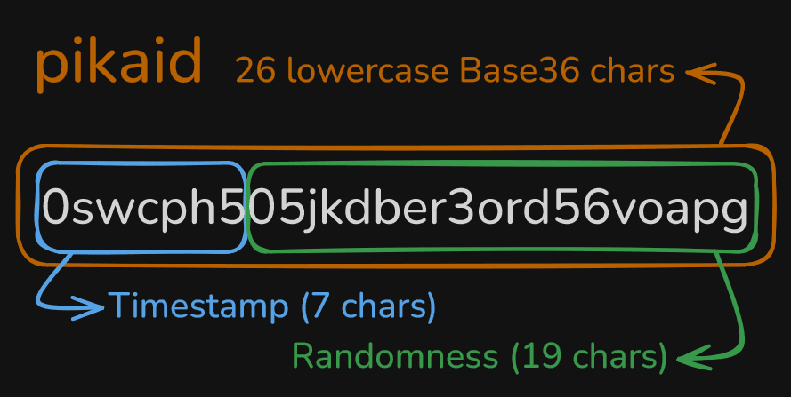

<p align="center">
  
</p>

# Pikaid Specification v1.0.2

> Compact, Sortable, Secure Identifiers

## Notational Conventions

The key words "MUST", "MUST NOT", "REQUIRED", "SHALL", "SHALL NOT", "SHOULD", "SHOULD NOT", "RECOMMENDED", "MAY", and "OPTIONAL" in this document are to be interpreted as described in [RFC 2119][rfc2119] and [RFC 8174][rfc8174].

[rfc2119]: https://www.rfc-editor.org/rfc/rfc2119
[rfc8174]: https://www.rfc-editor.org/rfc/rfc8174

## 1. Overview

Pikaid is a 26-character, lowercase Base36 identifier designed for:

- **Compactness**: 26 characters (same as ULID, shorter than UUID).
- **Sortability**: Lexicographic ordering matches chronological ordering.
- **Security**: 96 bits of cryptographic randomness.

A Pikaid value consists of a 7-character timestamp prefix followed by 19 characters of randomness, using only the characters `0-9` and `a-z`.

## 2. Terminology

- **Pikaid**: The identifier format defined by this specification.
- **pikaid** (lowercase, in code contexts): A specific identifier value conforming to this specification.
- **Timestamp**: Unsigned integer representing seconds elapsed since 1970-01-01T00:00:00 UTC (Unix epoch).
- **Entropy**: Cryptographically secure random data.
- **CSPRNG**: Cryptographically Secure Pseudo-Random Number Generator, as provided by operating system facilities (e.g., `/dev/urandom`, `getrandom()`, `CryptGenRandom`).
- **Base36**: Positional numeral system using digits `0-9` and letters `a-z` (36 symbols total).

## 3. String Format



A valid Pikaid string MUST be exactly 26 characters, matching the regular expression:

```
^[0-9a-z]{26}$
```

### 3.1 Layout

| Position   | Length | Content                     |
|------------|--------|-----------------------------|
| 0–6        | 7      | Timestamp (Base36, seconds) |
| 7–25       | 19     | Randomness (Base36, 96 bits)|

### 3.2 Alphabet

The alphabet consists of exactly 36 characters:

```
0123456789abcdefghijklmnopqrstuvwxyz
```

Character values are assigned sequentially: `0` = 0, `1` = 1, ..., `9` = 9, `a` = 10, `b` = 11, ..., `z` = 35.

Implementations MUST use lowercase letters exclusively. Uppercase letters MUST NOT be accepted or produced.

### 3.3 Timestamp Component

- The first 7 characters encode the Unix timestamp in Base36.
- The value MUST be left-padded with `0` characters to ensure exactly 7 characters.
- Valid timestamp range: 0 to 78,364,164,095 inclusive (36<sup>7</sup> − 1).
- This range covers dates from 1970-01-01T00:00:00 UTC through approximately 4453-04-07 UTC.
- Negative timestamps MUST NOT be used.

### 3.4 Randomness Component

- The remaining 19 characters encode exactly 96 bits (12 bytes) of entropy.
- The value MUST be left-padded with `0` characters to ensure exactly 19 characters.
- The entropy MUST be obtained from a CSPRNG.
- Implementations MUST NOT use non-cryptographic random sources (e.g., `rand()`, `mt_rand()`, `Math.random()`).

### 3.5 Ordering Guarantee

Both string and binary forms MUST preserve lexicographic ordering such that:

- For any two Pikaid values A and B, if A was generated at time T<sub>A</sub> and B at time T<sub>B</sub>, and T<sub>A</sub> < T<sub>B</sub>, then A < B lexicographically.
- Within the same second, ordering is determined by the randomness component.

## 4. Binary Format

Pikaid defines a compact 17-byte binary representation for storage efficiency.

### 4.1 Layout

All multi-byte integers are encoded in big-endian (network) byte order.

| Offset | Length | Content                              |
|--------|--------|--------------------------------------|
| 0–4    | 5      | Timestamp (40-bit unsigned integer)  |
| 5–16   | 12     | Randomness (96 bits)                 |

**Total**: 17 bytes

### 4.2 Requirements

- Implementations MUST support lossless, reversible conversion between the 26-character string form and the 17-byte binary form.
- The binary buffer MUST be exactly 17 bytes; inputs of any other length MUST be rejected.
- The timestamp field MUST be encoded as a 40-bit unsigned big-endian integer.
- The randomness field MUST be preserved exactly; no bit manipulation, truncation, or re-encoding is permitted.
- Binary lexicographic ordering MUST equal chronological ordering.

### 4.3 Database Mapping

When storing Pikaid values in databases, implementations SHOULD use:

- `BINARY(17)` or equivalent fixed-length binary column for the binary form.
- `CHAR(26)` or `VARCHAR(26)` for the string form.

## 5. Generation

### 5.1 String Generation

To generate a Pikaid string, an implementation MUST:

1. Obtain the current Unix timestamp in seconds.
2. Validate that the timestamp is within the range 0 to 78,364,164,095 inclusive.
3. Encode the timestamp in Base36 and left-pad with `0` to 7 characters.
4. Obtain 12 bytes (96 bits) from a CSPRNG.
5. Encode the 12 bytes as a big-endian unsigned integer in Base36 and left-pad with `0` to 19 characters.
6. Concatenate the timestamp and randomness strings.

### 5.2 Binary Generation

To generate a Pikaid in binary form, an implementation MUST:

1. Obtain the current Unix timestamp in seconds.
2. Validate that the timestamp is within the range 0 to 78,364,164,095 inclusive.
3. Encode the timestamp as a 5-byte big-endian unsigned integer.
4. Obtain 12 bytes (96 bits) from a CSPRNG.
5. Concatenate the timestamp and randomness bytes.

### 5.3 Custom Timestamp Generation

Implementations MAY provide functions to generate Pikaid values using a caller-supplied timestamp. Such functions:

- MUST validate the timestamp range.
- MUST still use a CSPRNG for the randomness component.
- Are useful for testing, migrations, or backfilling historical data.

## 6. Validation

### 6.1 String Validation

To validate a Pikaid string, an implementation MUST verify:

1. **Length**: The string is exactly 26 characters.
2. **Characters**: Every character matches `[0-9a-z]`.
3. **Timestamp range**: The decoded timestamp does not exceed 78,364,164,095.

An implementation MUST reject invalid input by raising an error or exception. Silent coercion or fallback values MUST NOT occur.

### 6.2 Binary Validation

To validate a Pikaid binary, an implementation MUST verify:

1. **Length**: The buffer is exactly 17 bytes.
2. **Timestamp range**: The decoded 40-bit timestamp does not exceed 78,364,164,095.

An implementation MUST reject invalid input by raising an error or exception.

## 7. Parsing

When parsing a valid Pikaid, implementations MUST be capable of extracting:

- **Timestamp**: As an integer (seconds since Unix epoch).
- **Randomness**: As raw bytes (12 bytes).

Implementations SHOULD also provide:

- **Timestamp**: As a UTC datetime object.
- **Randomness**: As a lowercase hexadecimal string (24 characters).

Timestamp extraction MUST NOT lose precision (i.e., the full integer value MUST be recoverable).

## 8. Interoperability

- Implementations MUST be able to parse and validate Pikaid values generated by any other compliant implementation.
- Implementations MUST produce output that any other compliant implementation can parse and validate.
- Custom alphabets, separators, prefixes, suffixes, or checksums MUST NOT be introduced by compliant implementations.

## 9. Conformance

This specification defines an official conformance test suite.

### 9.1 Official Test Vectors

Implementations claiming compliance with Pikaid Specification v1.0.2 MUST pass all official test vectors for v1.0.2.

The official test vectors are published alongside this specification and are considered normative.

- Test vectors file: `conformance/pikaid-v1.0.2.vectors.json`
- Optional schema: `conformance/pikaid-v1.0.2.schema.json`

### 9.2 Requirements

A conforming implementation MUST:

1. Produce exactly the expected string and binary outputs for all valid vectors.
2. Reject all invalid vectors (string and binary) according to the validation rules in Sections 6.1 and 6.2.
3. Perform lossless round-trip conversions between string and binary forms where required by the vectors.

Implementations SHOULD also include randomized property-based tests (e.g., repeated generation and validation), but such tests are not required for compliance.

## 10. Error Handling

Implementations MUST signal errors for the following conditions:

| Condition                       | Trigger                                                   |
|---------------------------------|-----------------------------------------------------------|
| Invalid string length           | Input string is not exactly 26 characters                 |
| Invalid character               | Input contains characters outside `[0-9a-z]`              |
| Timestamp overflow              | Decoded timestamp exceeds 78,364,164,095                  |
| Timestamp underflow             | Timestamp is negative (generation only)                   |
| Invalid binary length           | Binary input is not exactly 17 bytes                      |

Implementations SHOULD provide descriptive error messages identifying the specific failure condition.

## 11. Security Considerations

- The 96-bit randomness provides collision resistance. The 50% birthday-bound probability requires approximately 1.51 × 10<sup>14</sup> identifiers.
- Randomness MUST come from a CSPRNG to prevent predictability attacks.
- Pikaid values reveal their creation timestamp with second precision. Applications requiring timestamp confidentiality SHOULD encrypt or otherwise obscure Pikaid values.
- Pikaid does not include a checksum. Transmission errors are not detected by validation alone.

## 12. Versioning

- This document specifies Pikaid version 1.
- The version is implicitly identified by the string length (26 characters).
- Future versions, if any, MUST use a different string length to ensure unambiguous version detection.
- The current specification version is v1.0.2.

---

## Appendix A: Design Rationale

*This section is informative.*

### A.1 Base36 Alphabet

Base36 (`0-9`, `a-z`) was chosen because:

- It is universally understood; no custom lookup tables are required.
- Lowercase-only output avoids case-sensitivity issues across filesystems, URLs, and databases.
- Native lexicographic sorting in databases produces chronological ordering without casting or special functions.

### A.2 Timestamp Precision

Second-level precision (rather than millisecond) was chosen because:

- 7 Base36 characters provide coverage through year ~4453, well beyond practical needs.
- Second precision is sufficient for most ordering use cases.
- Higher precision would require additional characters, reducing compactness.

### A.3 96-bit Entropy

96 bits of randomness was chosen because:

- It encodes cleanly into 19 Base36 characters (36<sup>19</sup> > 2<sup>96</sup>).
- It provides substantially more collision resistance than ULID (80 bits).
- The birthday-bound (~10<sup>14</sup> IDs) exceeds any practical generation volume.

### A.4 No Separators or Checksum

- Separators add overhead and complicate parsing with no functional benefit.
- Checksums are unnecessary given the 96-bit entropy; accidental collision from typos is statistically negligible.

### A.5 Implicit Version Identification

Version is determined by string length rather than embedded flags. This:

- Avoids consuming character positions for version indicators.
- Allows parsers to distinguish versions by length alone.
- Ensures forward compatibility if future versions require different bit budgets.

---

## Appendix B: Comparison

*This section is informative.*

| Format     | Length | Sortable | Random Bits | Alphabet           | Valid Until  |
|------------|:------:|:--------:|:-----------:|--------------------|--------------| 
| **Pikaid** | 26     | Yes      | 96          | Base36 (lowercase) | ~4453        |
| UUIDv1     | 36     | Yes      | 14          | Hex + dashes       | N/A          |
| UUIDv4     | 36     | No       | 122         | Hex + dashes       | N/A          |
| UUIDv6     | 36     | Yes      | 62          | Hex + dashes       | N/A          |
| UUIDv7     | 36     | Yes      | 74          | Hex + dashes       | N/A          |
| ULID       | 26     | Yes      | 80          | Crockford Base32   | ~10889       |
| NanoID     | 21     | No       | ~126        | Custom 64-char     | N/A          |

*Refer to individual specifications for precise entropy calculations and alphabet definitions.*

---

## Appendix C: Optional Features

*This section is informative.*

Implementations MAY provide additional utilities that do not affect core compliance:

- Pretty-print or debug output functions.
- Comparison functions (note: string comparison is sufficient due to lexicographic ordering).
- Database helper functions for type mapping.
- Batch generation functions.
- Extraction of timestamp as various datetime types.
- Extraction of randomness in various formats (hex, base64, raw bytes).

Such features MUST NOT alter the generation, validation, or parsing behavior defined in the normative sections.

---

## Appendix D: Benchmark

*This section is informative.*

### PHP (60,000 iterations)

| Library    | Implementation        | Median µs/op | Ratio  |
|------------|-----------------------|-------------:|-------:|
| **Pikaid** | pikaid/pikaid-php     | 0.9          | 1.0×   |
| NanoID     | hidehalo/nanoid-php   | 2.1          | 2.4×   |
| ULID       | robinvdvleuten/ulid   | 2.0          | 2.4×   |
| UUIDv1     | ramsey/uuid           | 5.0          | 5.9×   |
| UUIDv4     | ramsey/uuid           | 1.3          | 1.6×   |
| UUIDv6     | ramsey/uuid           | 5.4          | 6.4×   |
| UUIDv7     | ramsey/uuid           | 2.7          | 3.2×   |

**Benchmark context:**
- 30 passes × 60,000 iterations per subject
- Warm-up: 60,000 iterations
- PHP 8.3.6 with `ext-gmp`
- CPU: AMD Ryzen 7 5800X, 32 GB DDR4 3200 MHz
- OS: Windows 11 Pro 23H2 (build 22631)
